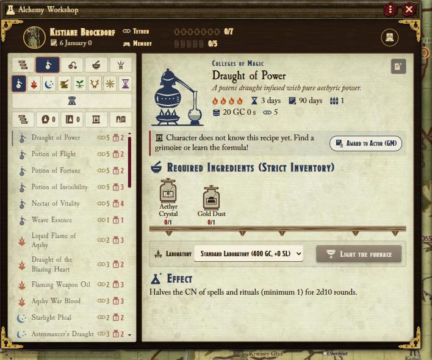
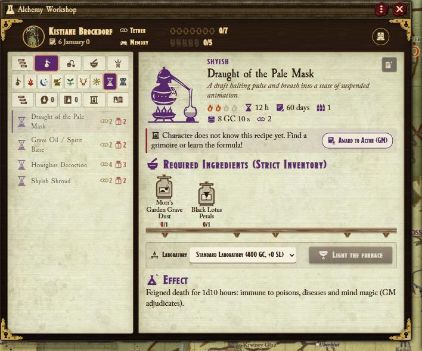
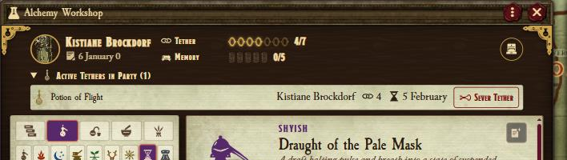
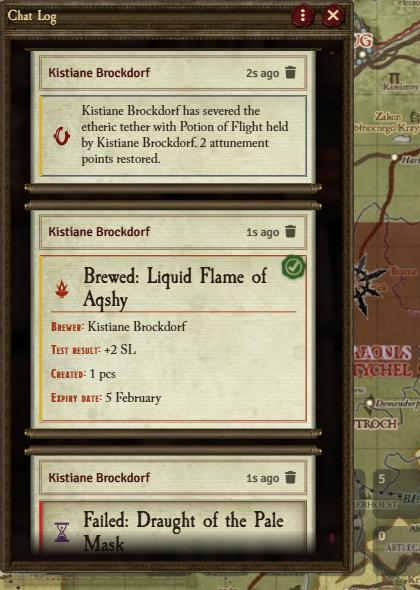

# WFRP4e – Old World Alchemy (`wfrp4e-alchemy`)

**English** | [Polski](README.pl.md)

A module for **Foundry VTT v14** and the **Warhammer Fantasy Roleplay 4th Edition** system. It replaces the standard potion-making procedure with an **Alchemical Workshop**:

* **Magical draughts** of the eight Colleges are brewed quickly and stay potent only while the alchemist sustains them with their **magical tether** (tether points tied to the alchemist's magic).
* **Mundane alchemy, apothecary and herbalism** stay close to the official rules: longer creation times, ingredient costs and list prices from the rulebooks.

The interface follows Foundry's language: **English** or **Polish** (any other language falls back to English).

---

## 📥 Installation

In Foundry: **Add-on Modules → Install Module**, paste this into *Manifest URL*:

```
https://github.com/TomasWarchol/wfrp4e-alchemy/releases/latest/download/module.json
```

Foundry also installs the required **WFRP4e – Companion Library** (`wfrp4e-companion-lib`) and **WFRP4e – Grimoires** (`wfrp4e-grimoires`). Enable all three modules in your world.

## 📦 Requirements

* Foundry VTT v14 and the WFRP4e system 10.0+.
* **WFRP4e – Companion Library** (`wfrp4e-companion-lib`).
* **WFRP4e – Grimoires** (`wfrp4e-grimoires`) 0.6+.
* Optional: Simple Calendar (otherwise Foundry's calendar is used), the official WFRP4e content modules (extra ingredients and recipes appear when their modules are active).

---

## ⚗️ Features

* **Alchemical Workshop** per character: recipes grouped by College and craft, required ingredients, test skill, creation time, number of doses and price.
* **Tether points**: each magical potion keeps a share of the alchemist's tether while it exists. Giving a potion to an ally keeps the tether; when the potion is used or dissolved, the points return.
* **Recipe memory**: the alchemist remembers a limited number of recipes; more come from **alchemical books** in the inventory: their own section and kind of book, in the same window as spellbooks, holding 12 recipes by default (the GM can change it). An alchemical book works just by being in the inventory; it isn't held or equipped. Spellbooks can still hold recipes next to spells. Opening a **recipe scroll** lets the character memorise it, which uses up the scroll.
* **Brewing test** with modifiers shown in the WFRP4e test dialog; the result and the brewed potion go to the chat and the inventory.
* **Potion effects** built on WFRP4e effect scripts: conditions, armour, characteristic and skill bonuses, healing; combat potions can be **thrown** at a target from the item's context menu.
* **Spoilage** of mundane preparations over the seasons.
* **Alchemical ingredients** have their own inventory section. Create one with **Alchemical ingredient** in the Create Item dialog, turn any trapping into one with **Make into alchemical ingredient** in its sheet header, or use the section’s **+** to open the ingredients compendium.
* **Compendia** generated by the module: ingredients, potions, recipe scrolls and grimoires (rebuilt in the world's language).
* **Recipe editor** for the GM and per-character GM settings (player access, tether and memory modifiers, visible Colleges).

## 🎨 Workbench look

By default (client setting **Workshop look**) the workshop looks like an alchemist's laboratory: the recipe book on the left with tradition tabs and the eight wind sigils, the workbench on the right with the tradition's vessel tinted in the wind's colour, ingredients as jars on a shelf and a **Light the furnace** button. The tether is a gold chain with one link per point and a list of the potions that hold it; recipe memory is a shelf of scrolls. GM tools sit in a drawer. *Classic* keeps the previous look.

| | |
|---|---|
|  |  |
|  |  |

## 🛠️ Opening

* The flask icon in the character sheet header (after the GM enables the module for that character in the **Companion Hub**, `/hub`).
* Macro: `game.alchemy.openWorkshop()` or `game.alchemy.openWorkshop(actor)`.

---

Unofficial fan content, not affiliated with Games Workshop or Cubicle 7. Code under the [MIT licence](LICENSE).
