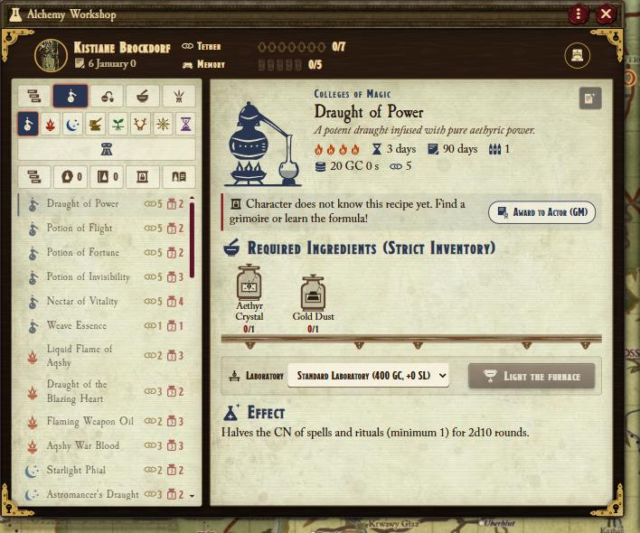
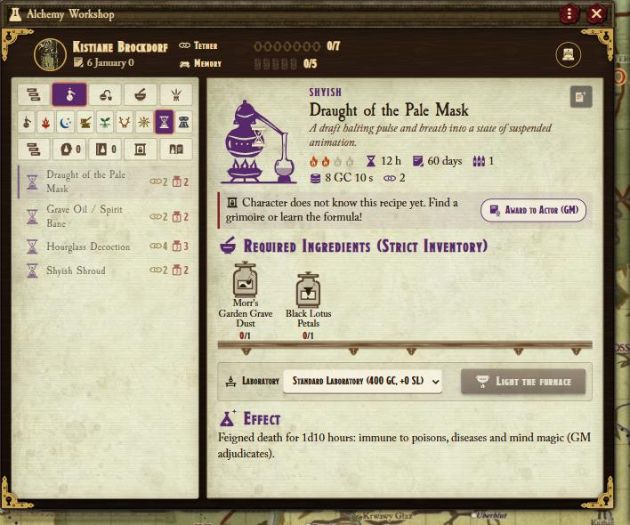
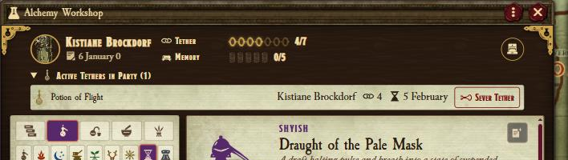
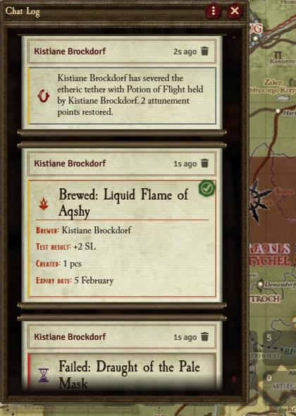

# WFRP4e – Alchemia Starego Świata (Old World Alchemy) (`wfrp4e-alchemy`)

[English](README.md) | **Polski**

Moduł do **Foundry VTT v14** dla systemu **Warhammer Fantasy Roleplay 4th Edition**. Zastępuje standardowe warzenie mikstur **Warsztatem Alchemicznym**:

* **Mikstury magiczne** ośmiu Kolegiów warzy się szybko, a ich moc trwa, dopóki alchemik podtrzymuje je swoją **Więzią** (punkty podtrzymania związane z magią alchemika).
* **Alchemia świecka, aptekarstwo i zielarstwo** trzymają się zasad z podręczników: dłuższy czas przygotowania, koszt składników i ceny katalogowe.

Język interfejsu przełącza się razem z językiem Foundry (polski lub angielski; inne języki dostają angielski).

---

## 📥 Instalacja

W Foundry: **Dodatki → Zainstaluj moduł**, w polu *Manifest URL* wklej:

```
https://github.com/TomasWarchol/wfrp4e-alchemy/releases/latest/download/module.json
```

Foundry doinstaluje też wymaganą bibliotekę **WFRP4e – Companion Library** (`wfrp4e-companion-lib`) oraz moduł **WFRP4e – Grimoires** (`wfrp4e-grimoires`). Włącz wszystkie trzy moduły w świecie.

## 📦 Wymagania

* Foundry VTT v14 i system WFRP4e 10.0+.
* **WFRP4e – Companion Library** (`wfrp4e-companion-lib`).
* **WFRP4e – Grimoires** (`wfrp4e-grimoires`) 0.6+.
* Opcjonalnie: Simple Calendar (bez niego moduł korzysta z kalendarza Foundry) oraz oficjalne moduły z treścią WFRP4e. Receptury i składniki z podręcznika (Podręcznik Główny, Wiatry Magii, Zestaw Startowy i inne) pojawiają się tylko wtedy, gdy oficjalny moduł Foundry tego podręcznika jest włączony w świecie; sam moduł tłumaczenia się nie liczy. Bez nich moduł oferuje tylko własne receptury.

---

## ⚗️ Funkcje

* **Warsztat Alchemiczny** dla postaci: receptury według Kolegiów i rzemiosł, wymagane składniki, umiejętność testu, czas przygotowania, liczba dawek i cena.
* **Punkty Więzi**: każda magiczna mikstura zajmuje część Więzi alchemika, dopóki istnieje. Przekazanie mikstury sojusznikowi nie zrywa Więzi; zużycie lub rozwiązanie mikstury zwraca punkty.
* **Pamięć receptur**: alchemik pamięta ograniczoną liczbę receptur; kolejne dają **księgi alchemiczne** w ekwipunku: osobny dział i rodzaj księgi, w tym samym oknie co księgi zaklęć, domyślnie na 12 receptur (MG może to zmienić). Księga alchemiczna działa, gdy po prostu jest w ekwipunku – nie trzyma się jej w rękach i nie zakłada. Księgi zaklęć nadal mogą zawierać receptury obok zaklęć. Otwarcie **zwoju receptury** pozwala ją zapamiętać, co zużywa zwój.
* **Test warzenia** z modyfikatorami widocznymi w oknie testu WFRP4e; wynik i mikstura trafiają na czat i do ekwipunku.
* **Efekty mikstur** oparte na skryptach efektów WFRP4e: stany, pancerz, premie do cech i umiejętności, leczenie; mikstury bojowe można **rzucić** w cel z menu kontekstowego przedmiotu: zasięg to Bonus Siły z progami zasięgu systemu, mikstury wybuchowe trafiają wszystkich w promieniu wybuchu, przed proszkami i truciznami cel broni się testem, a dym, mgła cienia i trujące opary zostają na scenie jako obszar, który zasłania widok albo co turę wymaga testu.
* **Mikstury się nie dublują:** ta sama mikstura wypita ponownie tylko odnawia czas działania, a z kilku mikstur wzmacniających tę samą cechę albo test liczy się najwyższa premia (kary nadal się sumują).
* **Nałóg** (zasada domowa, ustawienie świata, domyślnie włączone): mikstury uzależniające wymagają Testu Opanowania po każdej dawce; uzależniona postać ma −10 w czasie głodu i co rano bez dawki zdaje Test Siły Woli.
* **Psucie się** świeckich preparatów z upływem sezonów.
* **Składniki alchemiczne** mają własny dział w ekwipunku. Nowy składnik tworzy pozycja **Składnik alchemiczny** w oknie tworzenia przedmiotu, a każdy przedmiot zamienia w składnik przycisk **Zamień w składnik alchemiczny** w nagłówku jego arkusza; **+** w dziale otwiera kompendium składników.
* **Kompendia** generowane przez moduł: składniki, mikstury, zwoje receptur i księgi (odbudowywane w języku świata).
* **Edytor receptur** dla MG i ustawienia MG dla postaci (dostęp gracza, modyfikatory Więzi i pamięci, widoczne Kolegia).

## 🎨 Wygląd pracowni

Domyślnie (ustawienie klienta **Wygląd warsztatu**) warsztat wygląda jak pracownia alchemika: po lewej receptariusz z zakładkami tradycji i sigilami ośmiu wiatrów, po prawej stół roboczy z naczyniem tradycji w kolorze wiatru, składnikami jako słojami na półce i przyciskiem **Rozpal palenisko**. Więź to złoty łańcuch z ogniwem na każdy punkt i listą mikstur, które ją trzymają; pamięć receptur to półka ze zwojami. Narzędzia MG są w szufladzie. *Klasyczny* zostawia dotychczasowy wygląd. Zrzuty pokazują interfejs angielski.

| | |
|---|---|
|  |  |
|  |  |

## 🛠️ Uruchomienie

* Ikona kolby w nagłówku karty postaci (gdy MG włączy moduł dla tej postaci w **Centrum Dodatków MG**, `/hub`).
* Makro: `game.alchemy.openWorkshop()` lub `game.alchemy.openWorkshop(actor)`.

---

Nieoficjalna twórczość fanowska, niezwiązana z Games Workshop ani Cubicle 7. Kod na [licencji MIT](LICENSE).
